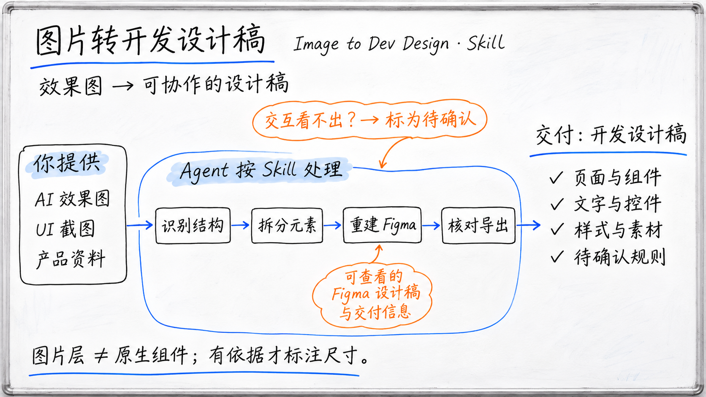
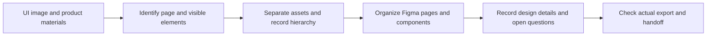

# Image to Developer-Ready Design

**Turn AI-generated or existing software UI images into Figma designs that designers and developers can review together.**



*AI-generated concept image; not an actual product interface or acceptance screenshot.*

AI image tools can create a visual direction quickly. Before implementation, developers still need to understand the page structure, reusable elements, text and assets, dimensions and styles, as well as interactions the image cannot show. This project packages a reusable Agent Skill for image analysis, design reconstruction, and developer handoff.

[简体中文](README.md) · **English**

[View the Skill](skills/image-layer-extraction/SKILL.md) · [Quick start](#quick-start) · [Workflow](#workflow) · [Delivery and verification](#delivery-and-verification)

The Skill ID is `image-layer-extraction`. In Codex, invoke it with `$image-layer-extraction`.

## Why this Skill exists

AI image tools can quickly produce a UI concept, but a flattened image often combines headings, icons, buttons, photos, and backgrounds. Developers still have to determine what the page contains, which parts may be reusable, how to read the dimensions and styles, and how states and interactions should work.

This Skill guides an Agent to identify visible structure in a UI image, organize it into a layered and inspectable Figma design, and record information needed for collaboration with developers. It distinguishes what can be observed in the image, what is supported by product materials, and what still needs confirmation from product or design.

## Suitable tasks

| Input | Design information to prepare |
| --- | --- |
| AI-generated software UI image | Page regions, visible elements, text and assets, layout relationships, and open questions |
| UI screenshot or static design | Semantic layers, original positions, asset list, and editable structure |
| Multiple pages or states of one interface | Page hierarchy, reusable elements, state differences, and cross-image questions |
| Figma handoff for developers | Verifiable dimensions, spacing, type, colors, assets, and unresolved interaction or responsive rules |

Page count, layer granularity, and component grouping depend on the input and task scope. A single static image cannot establish a full business flow, and guesses are not presented as confirmed rules.

## What it delivers

The deliverables vary with the task and may include:

- **Page and layer structure:** Semantic groups for page regions, text, icons, images, buttons, and backgrounds.
- **Figma design:** An inspectable node structure in the target file when tools are available. For software UI designs, readable text, basic controls, and reusable elements are prioritized as native nodes where possible; complex illustrations and photos remain separate image layers, with editability stated for each part.
- **Developer handoff notes:** Supported dimensions, spacing, typography, colors, assets, state differences, and implementation questions.
- **Layer and asset manifest:** Source dimensions, asset positions, stacking order, content type, and extraction method for traceability.
- **Verification results:** Notes on individual layers, in-place reassembly, actual Figma export, and unresolved items.

Bitmap layers can be moved or replaced, but they are not the same as native text, vectors, or components. The handoff states the actual editability of each part; a full screenshot is not used as the base of a supposedly completed design.

## A simple example

The following fictional request illustrates how to use the Skill. It is not a report of an actual reconstruction.

The input is an AI-generated mobile order-detail screen:

```text
Use $image-layer-extraction to turn this order-detail image into a Figma design for developer handoff.

Organize the page regions, order information, status labels, product image, and action buttons.
Record dimensions, spacing, colors, and text that can be verified from the image.
State which parts are native text, vectors, components, instances, or bitmap layers.
If the order-state transitions, button behavior, or narrow-screen rules are not in the source materials, list them as open questions.
Check the actual Figma export and provide the layer manifest and visual differences.
```

Developers can inspect the page structure and confirmed styles, while product owners can see which states and interactions need decisions. Hidden content that cannot be recovered from the image is not invented.

## Workflow



The original image remains the visual reference. Each conclusion is marked as directly observed, confirmed by materials, inferred, or still open. A static image alone cannot prove button behavior, error flows, permissions, or responsive changes.

## Delivery and verification

| Area | What to check |
| --- | --- |
| Content coverage | Each in-scope region, text, icon, image, and state has a corresponding layer or note |
| Editability | Whether each node is an image, native text, vector, component, or instance, and whether that matches the handoff |
| Visual reconstruction | Layer edges, dimensions, coordinates, stacking order, and in-place reassembly against the reference |
| Developer handoff | Confirmed styles, asset sources, states, and responsive information are separated from inferences and open questions |
| Figma output | The target file structure and actual export are visible and complete, without misalignment or clipping |

Local reassembly, reading node properties, and exporting from Figma are separate checks. If the Figma connection or target-file permissions are unavailable, the blocked step is reported; local preparation is not described as a completed remote design.

## Quick start

1. Copy the complete `skills/image-layer-extraction/` directory into the Agent's skills directory, keeping `SKILL.md` and `agents/openai.yaml` together.
2. In Codex with the Skill loaded, provide a software UI image and invoke `$image-layer-extraction`.
3. State whether you need image analysis or layer extraction, a Figma reconstruction, or a full-page design with developer handoff notes.
4. For an existing Figma file, provide its link and the target location. Writing and export verification require the relevant tool connection and permissions.

The project is presented as **Image to Developer-Ready Design**. Its Skill ID remains `image-layer-extraction` to preserve existing invocation paths.

## Scope and limitations

For software UI images, the workflow covers page and region structure, native text and basic controls where possible, evidence-based design notes and assets, and open questions for states, interactions, and responsive behavior that static images cannot establish. Actual editability, writing to the target file, and export results depend on source assets, Figma connectivity, and file permissions.

Complex materials, low-resolution content, translucent edges, and occlusion are limited by the source image. Generative extraction or inpainting is reported separately and is not called lossless recovery. Figma access, image tools, and data handling depend on the Agent, connected services, and account settings.

This repository provides Skill instructions and configuration. It does not include a standalone image-conversion program, model weights, or a Figma template.
