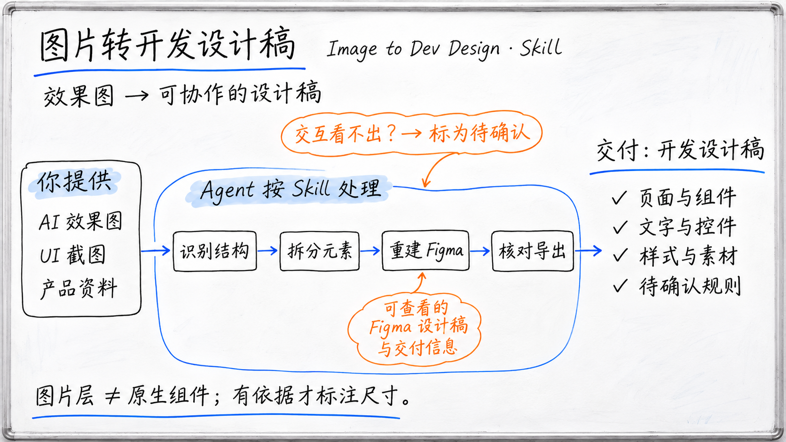
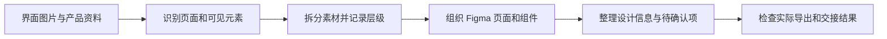

# 图片转开发设计稿

**把 AI 生成或已有的软件界面图片，整理成可与开发人员协作的 Figma 设计稿。**



*AI 生成的概念图，并非实际产品界面或验收截图。*

AI 生图可以很快呈现页面视觉。进入开发前，还需要弄清页面结构、可复用元素、文字与素材、尺寸和样式，以及效果图无法说明的交互规则。这个项目把图片分析、设计稿重建和开发交接整理成一个可复用的 Agent Skill。

**简体中文** · [English](README.en.md)

[查看 Skill](skills/image-layer-extraction/SKILL.md) · [快速开始](#快速开始) · [工作流程](#工作流程) · [交付与核验](#交付与核验)

Skill 的调用名为 `image-layer-extraction`，在 Codex 中可用 `$image-layer-extraction` 调用。

## 为什么做这个 Skill

AI 图片工具能快速给出界面的视觉方案，但一张合成图通常把标题、图标、按钮、图片和背景压在一起。开发人员仍要判断页面由什么组成、哪些部分可以复用、样式和尺寸如何读取，以及状态和交互该如何实现。

这个 Skill 指导 Agent 从界面图片中识别可见结构，整理成有层级、可检查的 Figma 设计稿，并记录开发协作需要的信息。它也会区分图片中能直接观察到的内容、由产品资料支持的规则，以及需要产品或设计人员确认的事项。

## 适合哪些工作

| 输入 | 可整理的设计资料 |
| --- | --- |
| AI 生成的软件界面图 | 页面区域、可见元素、文字与素材、布局关系和待确认项 |
| UI 截图或静态设计图 | 语义图层、原图位置、素材清单及可编辑结构 |
| 一组页面或同一界面的多个状态 | 页面层级、可复用元素、状态差异和跨图待核对内容 |
| 面向开发交接的 Figma 稿 | 可确认的尺寸、间距、字体、颜色、资源，以及尚未确定的交互和适配规则 |

页面数量、图层粒度和组件划分按输入与任务范围确定。Skill 不会从一张静态图推断完整业务流程，也不会把猜测写成已确认规则。

## 会交付什么

按任务范围组合以下结果：

- **页面与图层结构**：按语义命名并组织页面区域、文字、图标、图片、按钮和背景。
- **Figma 设计稿**：按目标文件和可用能力构建可检查的节点结构。软件界面稿优先将可读文字、基础控件和有复用价值的元素组织为原生节点；复杂插画和照片保留为独立图片层，并逐项说明实际编辑能力。
- **开发交接信息**：整理有来源的尺寸、间距、字体、颜色、素材、状态差异与实现疑问。
- **图层与素材清单**：记录源图尺寸、素材位置、层序、内容类型和处理方式，便于回查和替换。
- **核验结果**：说明单层质量、原位重组、Figma 实际导出，以及哪些内容仍待确认。

位图层可独立移动或替换，但这不等于原生文字、矢量或组件。交付时会说明实际编辑能力，不把整张截图放在底层当作完成的设计稿。

## 一个简单示例

以下为虚构的调用示例，用来说明输入和预期整理方向，不是一次实际还原结果。

输入是一张 AI 生成的移动端订单详情页。使用者可以这样提出任务：

```text
使用 $image-layer-extraction，把这张订单详情页效果图整理成开发协作设计稿。

在 Figma 中按页面区域、订单信息、状态标签、商品图片和操作按钮组织图层。
记录能够从原图确认的尺寸、间距、颜色和文字。
说明哪些内容是原生文字、矢量、组件或图片层。
订单状态如何变化、按钮点击后做什么、窄屏怎样适配，如果材料没有说明就列为待确认。
完成后核对 Figma 实际导出，并给我图层清单和差异说明。
```

开发人员可以据此查看页面组成和已确认样式，同时能看到需要产品补充的状态与交互问题。不能从图片中可靠恢复的隐藏内容不会自动补画。

## 工作流程



图片作为视觉依据保留。对于每项结论，区分直接观察、资料已确认、合理推断和待确认；静态图不能单独证明按钮行为、异常流程、权限规则或响应式变化。

## 交付与核验

| 核验对象 | 检查内容 |
| --- | --- |
| 内容覆盖 | 任务范围内的页面区域、文字、图标、图片和状态是否都有对应层或说明 |
| 编辑能力 | 节点实际是图片、原生文字、矢量、组件还是实例；是否与交付说明一致 |
| 画面还原 | 单层边缘、尺寸、坐标、层序与原位重组是否符合视觉依据 |
| 开发交接 | 已确认样式、素材来源、状态和适配信息，是否与推断及待确认项分开 |
| Figma 结果 | 目标文件中的结构及实际导出是否可见、完整、无错位或截断 |

本地重组、节点回读和 Figma 导出是不同的核验步骤。若 Figma 工具未连接或目标文件不可写，会说明具体受阻环节，不把未写入的本地准备稿描述成已完成的远端设计稿。

## 快速开始

1. 将仓库中的 `skills/image-layer-extraction/` 整个目录放入 Agent 的技能目录，并保留 `SKILL.md` 与 `agents/openai.yaml`。
2. 在支持该 Skill 的 Codex 中提供软件界面图片，使用 `$image-layer-extraction` 调用。
3. 说明交付范围：只分析或拆分素材、重建到 Figma，或制作包含开发交接信息的整页稿。
4. 若要修改已有 Figma 文件，提供目标链接和写入位置；实际写入与导出需要对应工具连接及权限。

README 所属项目名为“图片转开发设计稿”；Skill 标识仍为 `image-layer-extraction`，以保持已有调用方式。

## 当前范围与边界

软件界面转开发设计稿时，Skill 会梳理页面与区域结构，尽可能原生重建可读文字和基础控件，整理有依据的设计标注与素材来源，并把静态图无法证明的状态、交互和适配规则列为待确认。实际编辑能力、目标文件写入与导出结果取决于可用资源、Figma 连接和文件权限。

复杂材质、低清晰度内容、半透明边缘和遮挡区域受源图信息限制。生成式提取或补画会与原图提取分开说明，不能称作无损恢复。Figma 写入、图像处理工具和数据处理方式取决于使用的 Agent、连接与账户设置。

本项目发布的是 Skill 指令与配置，不附带独立的图像转换程序、模型权重或 Figma 模板。
